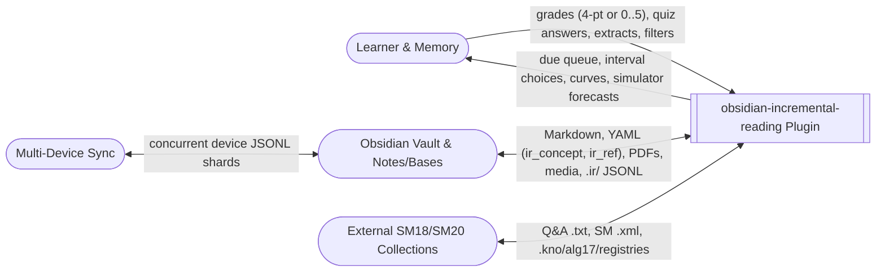

# Scope & Problem-Space Analysis: Full SuperMemo 20 Parity

> **Implemented on `main` (pending next release).** All six capability phases,
> STRIDE security hardening (`docs/SECURITY-THREAT-MODEL.md`), progressive UX
> polish, Schema v4 `alg17` binary parity, and the 5-algorithm Algorithm Arena
> with seeded dispersion and history replay are implemented and verified on
> `main`. This document preserves the problem-space analysis and architectural
> specification.

Grounded in the 100% decompiled and traced `sm20.exe` corpus (`~/code/sm20-re`, 15,468 SuperMemo functions across all Delphi units) and locked scoping decisions.

---

## 1. Problem-Space Context Model (`SPEC ∧ ASM ⇒ REQ`)

### World vs. Machine Boundary

- **World (problem space):**
  - The learner's biological memory, daily reading/review capacity, and subject priorities.
  - An existing Obsidian vault: Markdown notes, PDFs, local audio/video, YAML frontmatter consumed by Obsidian Bases/Dataview, and multi-device file sync (Obsidian Sync, Syncthing, Git).
  - Existing v0.14–v0.16 `.ir/` event ledgers and `sm20-matrix.json` (schema v2) caches built under interim approximations.
  - External SuperMemo 18/20 collections (`.kno` + `info/` + `elements/` + `registry/` + `alg17/`, XML exports, and Q&A text files).
- **Machine (solution space):**
  - The `obsidian-incremental-reading` plugin (`main.js` + `styles.css`, strictly zero-network, append-only `.ir/` event ledger + generation sidecars, non-modal keyboard-first Obsidian views).
- **Shared phenomena:**
  - Review grades (`4-point` default or `0..5` SuperMemo 6-point mode) and reading `Next` advances.
  - Editor/PDF/media extract captures, interactive quiz answers (cloze, typed Spell-Pad, MCQ, ordering, rectangular & polygon occlusion).
  - Collection filters, priority operations, Concept/Reference edits (synced between YAML frontmatter and `.ir/`), Stats/Simulator controls, and collection import/export files.

### Requirements (`REQ`)

- **REQ-1 (Algorithmic fidelity):** Item and reading schedules match `sm20.exe` (`TDatabase.AlgorithmOutcomes` `0x00d97fc0`, analytical `PA20` `0x00cacf30..0x00cad8d0`, matrix `PA19` `0x00cf3070`, `alg17/*.dat` grids, post-lapse `0x00ce0230`, growth floor `0x00cf29c0`) rather than interim approximations, while remaining losslessly switchable with FSRS-6.
- **REQ-2 (End-to-end SM-20 workflow):** Learners can simulate multi-year workload/retention, inspect per-item memory curves and calibration, filter elements across numeric/date ranges, search-and-replace subsets, redistribute priorities (`Spread Priorities`), audit/repair collection & history integrity, organize via Concept Groups and propagating Reference metadata, answer typed/MCQ/ordering/polygon-occlusion items, and round-trip SuperMemo collections (Q&A text, XML, binary/media) inside Obsidian.
- **REQ-3 (Upgrade & vault safety):** Upgrading existing v0.14–v0.16 vaults never corrupts user notes, never silently scrambles today's due dates, converges deterministically across synced devices, obeys `docs/UI-COMMITMENTS.md` (keyboard-first, single review surface, native look, non-modal), and passes the zero-network bundle check.

### Domain Assumptions (`ASM`) & Adversarial Stress-Test

1. **ASM-1 (Existing vault state):** *Initial assumption:* Existing `sm20-matrix.json` and `StoredCard` state are compatible with exact `sm20.exe` formulas.
   - *Violation risk:* **High** — v0.14–v0.16 used fixed `+0.04/-0.01` difficulty steps, heuristic post-review stability, placeholder FC weights, and only 4 of 8 `alg17` grids.
   - *Relaxed assumption & design response:* Existing vaults hold v2 approximated matrices and active `due` dates the user relies on. **SPEC:** Bump `sm20-matrix.json` to schema **v3**; on load, deterministically rebuild all `alg17` grids from `.ir/` review events + imported baselines while leaving existing `StoredCard.due` timestamps untouched until each item's next review.
2. **ASM-2 (Grading granularity):** *Initial assumption:* Every user wants 4 buttons or every user wants 6 buttons (`0..5`).
   - *Violation risk:* **Medium** — FSRS-6 requires 4 grades (`1..4`), mobile users need compact docks, while power SM-20 users want `0..5` (`0-2` fail, `3-5` pass) which directly parameterize `PA20` (`0x00cad380`, `0x00cad6a0`) and `PA19` (`0x00ce66e0`).
   - *Relaxed assumption & design response:* Support `gradingScale: "4-point" | "sm20-6-point"` (default `"4-point"` mapping `Again/Hard/Good/Easy -> 1/3/4/5`, optional `"sm20-6-point"` exposing `0..5` in review dock & keys `0..5` while mapping `0,1->Again`, `2,3->Hard`, `4->Good`, `5->Easy` when FSRS-6 is queried).
3. **ASM-3 (Frontmatter vs. ledger sync):** *Initial assumption:* Frontmatter edits only happen through plugin UI.
   - *Violation risk:* **High** — Users edit YAML frontmatter (`ir_concept`, `ir_ref`) directly in Obsidian or via Bases/Templates, or sync `.ir/` JSONL shards before note edits settle.
   - *Relaxed assumption & design response:* Treat `.ir/` events and note frontmatter (`ir_concept`, `ir_ref`) as bidirectionally reconciled with loop-suppression guards: manual YAML edits emit reconciled ledger events on metadata cache change, and ledger Concept/Reference mutations update note YAML via `app.fileManager.processFrontMatter` when a `notePath` exists.
4. **ASM-4 (Multi-device sync ordering):** *Initial assumption:* Reviews arrive in wall-clock order on one machine.
   - *Violation risk:* **High** — Synced JSONL shards arrive out of order across devices.
   - *Relaxed assumption & design response:* All 8 `alg17` grids (`StabilityIncrease`, `Recall`, `FirstInterval`, `ForgettingCurve`, `Retrievability`, `DifficultyDistribution`, plus case arrays) are deterministically foldable from `(baseline, events sorted by (lamport, id))`.
5. **ASM-5 (Excluded subsystems boundary):** *Locked domain rule:* Sleep/Circadian (`Sleep.tim` / `SleepRecall.dat`) and Day-planner/Tasklists remain outside the plugin (`docs/FUTURE-PLANS.md` §5); Concept Groups and Reference metadata propagation **are** inside scope.

### Software Specification (`SPEC`)

1. **Phase 1 — Exact SM-20 Core Scheduler, Algorithm Arena, `0..5` Grading & Full `alg17` v4 Parity:**
   - Implement exact `SM-20` (`0x00ce4810` / `0x00cacf30..0x00cad8d0`) with all 35 IEEE-754 weights extracted from `sm20.exe` (`*0x011a5bd0` at `0x0115f4d0`), exact `SM-19` (`0x00bc6ff0` difficulty update, `0x00ce6470` `sat(cases, 300)` + `0x00ce66e0` `(175, 0.01, 100, 0.1)` stability blend, `0x00cdeb50` 21³ grid seeding via `0x00cde2d0`), post-lapse rep-1 recovery (`0x00ce0230`), minimum interval growth floor (`0x00cf29c0`), U-Factor (`0x00cfa420`), SplitMix32-seeded `0x00cf2f30` interval dispersion (`hash(elementId, reps, lapses, smGrade, undoRollCount)`), and the full 5-algorithm **Algorithm Arena** (`0x00d97fc0` -> `0x00cf2b80` / `0x00d8b990`: `6% SM-2 + 14% SM-15 + 45% SM-19 + 25% SM-20 + 10% FSRS`, dynamically adapted via live LSRM recall accuracy and editable in Settings).
   - Upgrade `Sm20Matrix` to schema v4: `FirstInterval` (`2×21×21×36` `uint32`, read via `0x00cdfb60`), `ForgettingCurve` (`2×36` `uint32` with `0x00cf5290` log-1.4 bins, read via `0x00cf5590`), `Retrievability.dat` (Half A `76×30` `int32` case counts + Half B `38×30` `float64` recall sums per `0x00cc69e0`), and `DifficultyDistribution` (`20` `uint32`), rebuilding automatically from `.ir/` ledger + baseline and replaying item history (`replaySm20CardsFromEvents`) while preserving existing `due` timestamps.
   - Add optional 6-grade (`0..5`) SuperMemo grading scale (`gradingScale` setting, review dock buttons, `0..5` hotkeys, ledger `smGrade?: 0|1|2|3|4|5`).
2. **Phase 2 — Analytics, Long-Horizon Simulator, `TMemForm` & `TIntervalChoiceForm`:**
   - Upgrade Divergence / Interval Choice (`TIntervalChoiceForm` `0x00cec060`, `0x00ced7e0`, `0x00cef9b0`) with 5-model ensemble weights (`SM-2`, `SM-15`, `SM-18`, `SM-20`, `FSRS-6`), weighted average, left/right SD, and proposed vs minimum interval selection.
   - Implement `SimulateDayRepetitionsUpToDayCapacity` (`0x00e66750`) multi-year workload, retention, memorized-item, and backlog simulator in `IR Stats`.
   - Render per-item `TMemForm` (`0x00cdc860`) forgetting curve + repetition history markers inside Element Info (`I`), `Retrievability.dat` calibration curves + multi-model Brier/RMSE benchmark (`0x00a96f00`) in `IR Stats`, and SM-20 repetition log CSV export (`0x00ce16c0`).
3. **Phase 3 — Collection `TElementFilter`, Subset Search/Replace, `TSpreadPrioritiesDlg` & Integrity Audit/Repair:**
   - Implement `TElementFilter` (`0x00ca7040`) numeric/date range filtering (`priority`, `interval`, `aFactor`, `uFactor`, `stability`, `difficulty`, `retrievability`, `reps`, `lapses`, `postpones`, `lastReview`, `due`, `type`, `status`, `concept`) + inline Collection filter drawer + subset text search-and-replace (`0x00b797e0`).
   - Implement `TSpreadPrioritiesDlg` (`0x00d4e980`) linear redistribution (`minPriority`, `maxPriority`, `step`) across whole collection, branch subtree, or filtered subset via inline Collection drawer + command.
   - Implement `Recov` / `Rephist` (`0x00d32f50`, `0x00d0cdc0`, `0x00d0f060`) Collection & Repetition History Audit/Repair (orphan parents, parent cycles, duplicate/missing note paths, non-monotonic review timestamps, mismatched `reps`/`lapses`, missing schedules) with dry-run report and one-click ledger repair.
4. **Phase 4 — Concept Groups & Propagating Reference Metadata (`Frontmatter + .ir/ Sync`):**
   - Add `ConceptGroup` (`id`, `name`, `rootId`, `targetFolder`, `defaultPriority`, `template`) and `ReferenceMetadata` (`title`, `author`, `date`, `source`, `link`, `comment`) to ledger model + events.
   - Sync `ir_concept` and `ir_ref` YAML frontmatter bidirectionally with `.ir/` ledger on topic/extract/item notes; automatically propagate `ReferenceMetadata` and `ConceptGroup` (`targetFolder`, `defaultPriority`, `template`) when extracting or creating child items; expose inline Concept/Reference controls in Collection and Element Info (`I`).
5. **Phase 5 — Interactive Quiz Formats (Typed `Spell-Pad`, `MCQ`, `Ordering` & Polygon Occlusion):**
   - Typed-answer cloze (`{{c1:=answer::hint}}`) with `TSpellDlg` character-diff feedback and keyboard Enter-to-check.
   - Multiple-choice (`mcq` fenced/inline quiz block, deterministic shuffle, `1..9` keyboard pick) and Ordering (`order` sequence block, ↑/↓ keyboard & pointer reorder).
   - Polygon image occlusion (`PolygonRegion` normalized vertex list alongside `NormalizedRect` in `src/ir/occlusion.ts`, SVG editor & review mask).
6. **Phase 6 — Full SuperMemo Import & Export Surface:**
   - SuperMemo Q&A text import & export (`TImportTXTDlg` `0x00c435f0`: `Q:`/`A:` records + cloze markers).
   - SuperMemo XML collection import & export (`ImportElementFromXmlNode` `0x00c3bf30`: hierarchy, `LearningData`, `RepetitionHistory`, `ConceptGroup`, `References`).
   - Extend `sm-collection-import.ts` to import all 8 `alg17/*.dat` files, `concept.dat`, `References`, and `Sound`/`Video` registry entries into `MediaSelector` elements, plus wire binary SM18/SM20 export (`src/sm18-format-write.ts`) and XML/Q&A export commands.

### Satisfaction Argument

Under **SPEC 1–6** and relaxed **ASM 1–5**:
- Exact `PA20` + `PA19` + v3 `alg17` rebuild satisfies **REQ-1** without moving existing `due` dates (**REQ-3**).
- Non-modal Stats tabs, Element Info (`I`) curves, inline Collection drawers, frontmatter-synced Concepts/References, Markdown-native quiz formats, and Q&A/XML/binary import-export satisfy **REQ-2** while honoring every invariant in `docs/UI-COMMITMENTS.md` and the zero-network build check (**REQ-3**).
