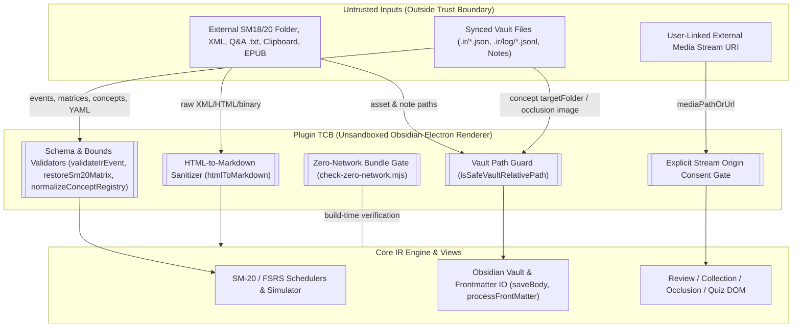

# Security Architecture & STRIDE Threat Model

Companion architectural threat model to [`SECURITY.md`](../SECURITY.md), covering the full SuperMemo 20 parity surface, `.ir/` multi-device sync ledger, importers/exporters, and Electron DOM rendering boundaries.

---

## 1. Security Requirements (CIA+)

- **Confidentiality (SR-C1):** Vault notes, extracts, review history, and filenames are never transmitted off the machine by plugin code; imported third-party collections cannot plant auto-loading remote tracking beacons (``, `<iframe>`, `<video>`) that phone home silently during review.
- **Integrity (SR-I1):** No imported file (`.xml`, `.txt`, `.dat`, `.epub`) or synced `.ir/` sidecar may create, overwrite, or read files outside the Obsidian vault root (`../`, leading `/`, drive colons, backslashes, NUL bytes), corrupt YAML frontmatter, pollute `Object.prototype`, or execute arbitrary JS/Node inside Obsidian's unsandboxed Electron renderer.
- **Integrity (SR-I2):** Malformed or tampered sidecars (`.ir/sm20-matrix.json`, `.ir/concepts.json`, `.ir/log/*.jsonl`) cannot poison live item scheduling (`NaN`/`Infinity` intervals) or silently destroy active card due dates.
- **Availability (SR-A1):** Crafted XML/Q&A/occlusion/reference inputs (deep XML nesting, oversized sidecars, thousands of polygon vertices, multi-megabyte reference footers) cannot exhaust the V8 call stack, amplify across child trees, or freeze the Obsidian UI.
- **Authenticity & Non-Repudiation (SR-AU1):** Every ledger mutation is recorded in append-only per-device JSONL shards (`device`, `lamport`, `id`, `ts`), and any opt-in external media stream displays its target URL/origin explicitly before user playback consent.
- **Authorization / Least Privilege (SR-AZ1):** Supply-chain and network privileges are structurally eliminated from the compiled artifact (`main.js` carries zero network APIs and a single exact-pinned runtime dependency, `ts-fsrs`).

---

## 2. Threat Model

| Attacker / Vector | Goal | Capabilities | Resources |
|---|---|---|---|
| **Crafted Shared Deck / Collection Author** | Execute code in Electron (`child_process`), write outside vault, track learner IP/timing via beacons, or hang Obsidian | Publishes `.xml`, `.txt`, `.epub`, or SM18/SM20 `.kno/.dat` collections that a user imports or pastes | Low–Medium (commodity web/script payloads, zip/path-traversal, XML bombs) |
| **Compromised Sync Peer / Cloud Storage** | Tamper with `.ir/log/*.jsonl`, `.ir/concepts.json`, or `.ir/sm20-matrix.json` to escape vault folders, inject DOM payloads, or corrupt schedules | Modifies files inside the synced vault directory | Medium (cloud bucket compromise, shared-folder peer) |
| **Supply-Chain / Transitive Package Attacker** | Exfiltrate indexed vault notes over the network | Compromises an npm package or build script | Medium–High |

---

## 3. Component Diagram & Trust Boundaries

---

## 4. STRIDE Threat Table

| Untrusted Element / Boundary | STRIDE | Concrete Attack Scenario | Likelihood / Impact | Mitigation Implemented |
|---|---|---|---|---|
| **External media stream URI (`MediaSelector`)** | **S**poofing | Shared note/deck labels an attacker tracking URL as a lecture stream; user clicks play blindly | M / M | **Mitigated:** External streams never preload; consent prompt displays the target URL (`src/review-view.ts`) before user opt-in per slot. |
| **SM XML / Q&A / HTML Import (`sm20-exchange.ts`, `html-to-markdown.ts`)** | **T**ampering & **E**levation of Privilege | Escaped `&lt;script&gt;`, `&lt;iframe&gt;`, `&lt;object&gt;`, or `onerror=` inside `<Question>`/`<Answer>` unescapes into active HTML in Electron's Node-enabled DOM | H / Critical | **Mitigated:** `sanitizeImportedRichText` routes HTML-bearing XML/Q&A fields through `htmlToMarkdown`, stripping `<script>`, `<iframe>`, `<object>`, `<embed>`, `<applet>`, `<meta>`, `<link>`, `<base>`, and inline attributes, escaping residual `<`. |
| **Concept `targetFolder`, Occlusion `image`, Import/Export paths** | **T**ampering & **E**levation of Privilege | Crafted `targetFolder: "../../..."` in `.ir/concepts.json` or `image: "../../..."` in `ir-occlusion` writes/reads outside vault root | M / High | **Mitigated:** Enforced `isSafeVaultRelativePath` / `assertVaultRelativePath` across `concepts-references.ts`, `ir-note.ts`, `tree-view.ts`, `occlusion.ts`, `html-to-markdown.ts`, `sm-collection-import.ts`, and `main.ts`. |
| **Synced `.ir/concepts.json` & `.ir/sm20-matrix.json` (v4)** | **T**ampering | `__proto__` / `constructor` concept IDs pollute prototypes; `NaN` / `-999` / `Infinity` in `sm20-matrix.json` poisons `SInc` and breaks review scheduling | M / M | **Mitigated:** `FORBIDDEN_IDS` + `SAFE_LEDGER_ID_RE` enforced on concept IDs; `restoreSm20Matrix` clamps `sinc` to `[0.5, 20]` (falling back to analytical priors), `retrievabilityCases` to non-negative `int32`, and `retrievabilitySums` to finite `[0, 1e9]`. |
| **Subset Search & Replace (`main.ts`)** | **T**ampering | `raw.replace` over full Markdown file corrupts YAML frontmatter keys or expands `$&` / `$$` replacement tokens | M / M | **Mitigated:** Uses `saveBody(app, file, afterText)` so YAML frontmatter is untouched and `$` sequences remain literal. |
| **Shared `.ir/log/*.jsonl` shards** | **R**epudiation | Conflicting edits across synced devices obscure which host mutated schedule/priority state | L / L | **Mitigated:** Append-only per-device JSONL shards (`device`, monotonic `lamport`, `EventId`) + Session Log (`Alt+L`) audit trail. |
| **Imported `` & supply chain** | **I**nformation Disclosure | Remote image beacons leak IP and review timestamps; compromised npm dependency exfiltrates vault | H / High | **Mitigated:** `htmlToMarkdown` drops external `http(s):` and `data:` image embeds to plain `alt` text; `scripts/check-zero-network.mjs` fails build on any network API or `http(s)://` literal in `main.js`; single pinned runtime dep (`ts-fsrs`). |
| **Deep XML, huge sidecars, polygon vertices, `#SuperMemo Reference:`** | **D**enial of Service | 10,000-deep `<SuperMemoElement>` overflows V8 call stack; 100 MB sidecar stalls startup; 10,000-char reference amplifies across 1,000 extracts; 50,000 polygon vertices freeze SVG | M / M | **Mitigated:** Iterative XML stack capped at depth `64` and `50,000` elements (`32 MB` input cap); `.ir/` sidecar reads capped (`8–16 MB`); reference fields capped at `2,048` chars; occlusion capped at `200` shapes × `500` vertices; subset search capped at `2,000` chars. |

---

## 5. Trusted Computing Base (TCB) per Requirement

1. **SR-C1 (Zero Exfiltration):**
   - *TCB:* `scripts/check-zero-network.mjs` (~65 LOC), `src/ir/html-to-markdown.ts` image-scheme stripper (~15 LOC), and the external media consent gate in `src/review-view.ts` (~25 LOC) — **~105 LOC total**, independent of the ~30K LOC scheduler/UI codebase!
2. **SR-I1 (Vault Path Confinement & Renderer Isolation):**
   - *TCB:* `src/ir/source-paths.ts` (`isSafeVaultRelativePath` / `assertVaultRelativePath`, ~30 LOC), `src/ir/html-to-markdown.ts` (~150 LOC), `escapeClozeHtmlFragment` (`src/cloze.ts`, ~10 LOC), and `validateIrEvent` (`src/ir/model.ts`, ~110 LOC).
3. **SR-I2 & SR-A1 (State Integrity & Bounded Resource Use):**
   - *TCB:* `restoreSm20Matrix`, `normalizeConceptRegistry`, `normalizeReference`, `parseOcclusionJson`, and `parseSuperMemoXmlCollection` bounds guards.

---

## 6. Residual Risks & Accepted Trade-offs

- **Obsidian / Electron Host Unsandboxed Execution (Accepted — Platform Constraint):** Co-installed community plugins share the same Node-enabled renderer (`SECURITY.md` §Scope). Our mitigations prevent *this* plugin and collections imported through it from escalating, but cannot isolate against a malicious co-installed plugin.
- **Markdown Renderer Surface in User-Authored Notes (Accepted with Defense-in-Depth):** Users intentionally writing raw HTML in their own Markdown notes are rendered by Obsidian's core `MarkdownRenderer.render`. Untrusted external imports (`.xml`, `.txt`, `.dat`, `.epub`) are sanitized to safe Markdown before entering the vault.
- **Cryptographic Shard Authenticity Across Untrusted Sync Peers (Accepted Risk):** `.ir/log/<device>.jsonl` attributes events by `device` ID for conflict resolution and auditability, not cryptographic signatures; a write-capable attacker inside the user's cloud sync folder already has direct write access to `.obsidian/plugins/` itself.
